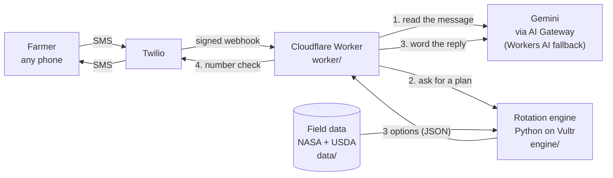
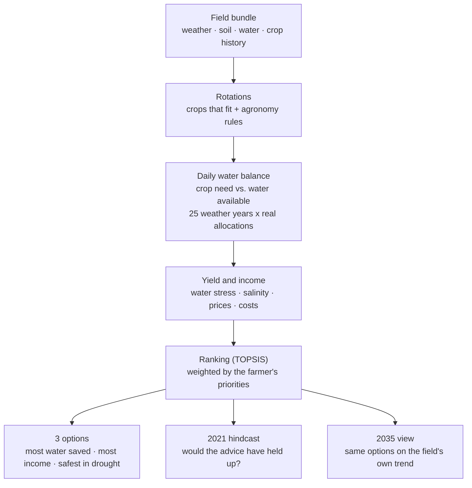

# FarmLine

**NASA's satellites, by text message.** A farmer sends one plain SMS from any phone, with no
internet, and gets back a crop rotation plan for their exact field: what to plant for the next
3 years to save water, protect income and stay safe in a drought.

> *"alfalfa 89406, water is short, what should I plant?"*
>
> FarmLine: Fallon, NV. Plans tested on 25 years of NASA weather.
> 1 saves the most water · 2 earns the most · 3 safest in a drought. Reply 1, 2 or 3 for details.

Built for the **NASA Space Apps Challenge 2026**, challenge *Field Shift: Adapting Farms with
NASA Data*.

**Live:** the SMS line runs end to end: Twilio → Cloudflare Worker → Gemini → rotation engine
on a Vultr server → reply. Health check:
[farmline-messaging.rs9459.workers.dev/health](https://farmline-messaging.rs9459.workers.dev/health).

**Live dashboard:** [farmline.rs9459.workers.dev](https://farmline.rs9459.workers.dev) shows the
questions answered, languages and places, with no phone numbers. It belongs to the second Worker,
which adds a call-in line and drought alerts (see [Phone line, alerts and dashboard](#phone-line-alerts-and-dashboard)).

**Team dashboard, demo view for judges:**
[farmline.rs9459.workers.dev/demo/cb2bd5d1970edc3bb6af80e7](https://farmline.rs9459.workers.dev/demo/cb2bd5d1970edc3bb6af80e7).
No sign-in needed. It is read-only and hides phone numbers. It shows every conversation and how
its answer was made.

> **Prototype.** The numbers come from real public data, but the crop and cost tables still
> contain labelled regional proxies and assumptions. FarmLine demonstrates the method; it is
> not validated farm advice yet.
>
> **How we will fix this.** Each proxy is labelled in the data, so it can be replaced one at a
> time. Next we will swap them for county-level USDA yields and prices and current university
> cost budgets, have a local extension agronomist review the crop tables, and check the plans
> against real farm records before calling the results advice.

## Why

Farmers have to choose rotations years ahead while rain, heat and water supplies shift. The
data that could guide them (25 years of weather, soil surveys, satellite crop maps, water
allocations) sits in archives and dashboards they never open. Many farms have no internet,
but every farmer can send a text.

What makes FarmLine different from a "pick a field on a map" website:

- **Text first.** Plain SMS on any phone. Replies in English, Hindi, Urdu (both also in Latin
  letters) and Swahili from fixed templates, and in other languages through checked
  translation.
- **Field memory.** The USDA Cropland Data Layer knows what grew on the field since 2008, so
  the farmer only sends a ZIP code or town.
- **Stress-tested.** Every rotation is replayed through 25 years of NASA weather and the water
  allocations farmers actually received, so the answer covers a bad year, not just an average
  one.
- **The farmer decides.** Three options, not one instruction.
- **No made-up numbers.** The engine computes; Gemini only words the result, and a checker
  blocks any reply containing a number the engine didn't produce.

## How it works



1. **Twilio** delivers the SMS to a **Cloudflare Worker**, which checks the signature and keeps
   a small memory per farmer in a Durable Object (so "tell me more about option 2" works).
2. **Gemini** turns the free-form text into structured facts: crop, place, whether water is
   being cut, and what the farmer cares about most. Only the message text is sent, never the
   phone number.
3. The **rotation engine** loads that field's data, scores every allowed three-year rotation of
   the crops that fit, and returns the best 3. Each field is prepared once and cached, so the
   engine answers a text in milliseconds.
4. **Gemini** writes the reply from the engine's numbers only. If the model is slow or a check
   fails, a fixed, number-checked template goes out instead, so the farmer always gets an
   answer inside Twilio's time limit.

### Inside the engine



- **Water balance:** reference evapotranspiration from NASA POWER (Hargreaves), crop
  coefficients from FAO-56, a soil-water bucket sized by the USDA soil survey. Irrigation stops
  when the year's water allocation runs out, which is how a drought reaches the field.
- **Rotations:** only crops with sourced parameters that pass the field's heat and frost-free
  checks; no heavy feeder after a heavy feeder, no annual crop three years running, at most
  one fallow year.
- **Yield and income:** water stress (FAO-33) and soil salinity (FAO-29) cut yields; USDA yields
  and prices, university enterprise budgets and the district's water charge turn them into
  dollars per acre.
- **Ranking:** each rotation is scored on water use, income, bad-year income (10th percentile)
  and soil health, then weighted by what the farmer asked for.
- **Hindcast:** the engine plans as if it were 2020, then replays 2021-2023 with the weather
  and water cuts that really happened, and compares the advice with staying in alfalfa.
- **2035 view:** the engine measures the field's own temperature and rain trend over 2001-2025
  (Mann-Kendall test, Sen's slope), shifts the weather to 2035 and reruns the three chosen
  options on it. Each plan says whether the trend is statistically significant. At Fallon it
  is +0.3 °C and +34 mm of rain per decade, and neither is significant, so the 2035 numbers
  barely move; FarmLine reports that instead of dressing it up.

## Data

| Dataset | Owner | What it does in FarmLine | Status |
|---|---|---|---|
| NASA POWER | NASA | 25 years of daily weather; drives the water balance and the stress test | In use |
| SSURGO soils | USDA NRCS | Water-holding capacity, salinity, slope | In use |
| Cropland Data Layer | USDA NASS | What grew on the field each year, 2008-2025 | In use |
| Newlands Project allocations | TCID, press and board minutes | The share of their water right farmers received each year | In use (11 sourced years) |
| TCID water charges | TCID rate schedule | Water cost per acre in the income model | In use |
| NWIS streamflow | USGS | Carson River flow; independent check on drought years | In use |
| OpenET | OpenET | Satellite-measured crop water use, to check the water balance | In use (validation) |
| FAO-56 / 33 / 29 crop tables | FAO | Crop water need, yield response, salt tolerance | In use (partial; gaps left blank) |
| NASS QuickStats and state overviews | USDA NASS | Yields and prices | In use (some labelled regional proxies) |
| University enterprise budgets | UNR Extension, UC Davis / UCCE | Production costs per acre | In use (historical, labelled) |
| SMAP, GPM IMERG, HLS NDVI, SRTM, ECOSTRESS | NASA | Current soil moisture, rainfall check, crop vigor, slope | Planned |

Every number has a source, and years or values with no source are left out, not estimated.
Full list with URLs and access dates: [docs/DATASETS.md](docs/DATASETS.md).

**Demo field:** an alfalfa field south of Fallon, Nevada, on the Newlands irrigation project.
Its soil is salty clay, it gets 78 to 307 mm of rain a year, and its water allocation fell to
20% in 2015 and 70% in 2021.

## Does the model hold up?

We checked the water balance against independent satellite data from
[OpenET](https://openetdata.org/) for 2016-2025 (`pipeline/openet_check.py`):

| Check | Result |
|---|---|
| Our reference ET (Hargreaves, NASA POWER) vs. gridMET reference ET | +5.7% per year, r = 0.992 |
| Our alfalfa water use vs. the OpenET ensemble, full-allocation years | +1.6% on average, worst year +12.4% |

In other words, the model's estimate of how much water the crop uses is within a few percent
of what satellites measured at this field.

## Tiger Data

The field data also lives in a [Tiger Cloud](https://www.tigerdata.com/) (TimescaleDB)
database, loaded by `pipeline/tiger.py` from the same files the engine reads:

| Table | Rows (Fallon) | Kind |
|---|---|---|
| `weather_daily` | 9,131 | Hypertable: 25 years of NASA POWER |
| `river_flow_daily` | 9,131 | Hypertable: USGS Carson River flow |
| `satellite_obs` | 240 | Hypertable, long form: OpenET today, SMAP and IMERG later |
| `weather_monthly` | 300 | Continuous aggregate over `weather_daily` |
| `requests` | 0 | Hypertable for farmer questions and plans (not written yet) |
| `fields`, `crop_history`, `water_allocations`, `county_yields`, `crop_prices` | small | Plain tables |

The schema is in [db/schema.sql](db/schema.sql). Loading a field twice gives the same rows. The
SMS line does not read from the database yet; it is the store for the dashboard and for
logging requests.

## Phone line, alerts and dashboard

A second Cloudflare Worker, in [farmline-worker/](farmline-worker/), takes FarmLine beyond the
one demo field. It answers texts and calls for any US ZIP code, Indian PIN code or town name.

- **Call-in line.** A farmer calls, picks a language, keys in a ZIP or PIN code and says their
  crop and problem. They hear the answer and get the same answer by SMS.
- **NASA weather for any place.** The last 30 days of rain and heat from NASA POWER, compared
  with the normal for those months. Where the rotation engine has the field's data, the reply
  adds the three plans. Where it does not, the reply gives the weather only and never claims a plan.
- **Drought alerts.** Farmers who reply `ALERT` are checked every day (Cron Triggers and Queues).
- **Ask anything.** General farming questions are matched by meaning to short answers that name
  their source (Workers AI and Vectorize).
- **Dashboard and admin view.** The public dashboard is the Worker's home page. An admin view
  behind a login (Auth0) shows each conversation and how its answer was made.

It also uses D1, KV, R2 and Durable Objects, and keeps the NASA readings it fetches in Tiger
Data. Setup, languages and SMS commands are in [farmline-worker/README.md](farmline-worker/README.md).

## Status

| Part | What works today |
|---|---|
| SMS line (`worker/`) | Signed Twilio webhook, per-farmer memory, STOP/HELP, full plan replies; deployed on Cloudflare |
| Phone line, alerts, dashboard (`farmline-worker/`) | Voice line, guided SMS, NASA weather for any place, daily drought alerts, farming library, public dashboard, admin view; deployed on Cloudflare |
| Gemini layer (`worker/src/gemini/`) | Message parsing in 6 language forms, checked replies, template fallback, number checker, Hindi speech |
| Engine (`engine/`) | Token-protected API, water balance, rotations, yields, ranking, hindcast, 2035 view, per-field cache; deployed on Vultr |
| Data (`pipeline/`, `data/`) | Real Fallon weather, soil, crop history, water allocations and charges, river flow, OpenET |
| Database (`db/`, `pipeline/tiger.py`) | Fallon loaded into Tiger Cloud: 4 hypertables and a monthly continuous aggregate |

**Known limits:** the crop and cost tables are prototypes (see the `docs/H2_*` to `docs/H5_*`
notes): some yields and prices are regional proxies, the cost budgets are historical, and the
salinity adjustment may double-count stress already present in USDA yields. Only the Fallon
field is loaded.

**Next:** NASA satellite signals (SMAP soil moisture, IMERG rainfall), the 2035 view in the SMS
reply, request logging to Tiger Data, more fields with full rotation plans, joining the two
Workers into one line, and WhatsApp.

## Repository

```
worker/      Cloudflare Worker (TypeScript): SMS webhook, Gemini layer, engine client
farmline-worker/  Second Worker: call-in line, drought alerts, farming library, dashboard
engine/      Rotation engine (Python, FastAPI)
pipeline/    Scripts that fetch each dataset into data/
data/        Field bundles and reference tables (crops, economics, places)
contracts/   The JSON the worker and engine exchange, with samples
db/          Tiger Data (TimescaleDB) schema
deploy/      Vultr server setup and redeploy scripts
docs/        Engine build plan, dataset list, crop-slice status notes
```

## Run it

**Engine** (Python 3.11+), from the repo root:

```bash
python -m venv engine/.venv
engine/.venv/Scripts/python -m pip install -r engine/requirements.txt   # bin/ instead of Scripts/ on macOS and Linux
engine/.venv/Scripts/python -m pytest engine/tests pipeline/tests
ENGINE_API_TOKEN=dev engine/.venv/Scripts/python -m uvicorn engine.app:app
```

**Worker** (Node 20+), in `worker/`:

```bash
npm install
npm test
npm run dev    # needs .dev.vars, copied from .dev.vars.example
```

**Tiger Data** (needs `DATABASE_URL` in `engine/.env`):

```bash
engine/.venv/Scripts/python -m pip install -r pipeline/requirements-tiger.txt
engine/.venv/Scripts/python -m pipeline.tiger nv-fallon-01
```

**Deploy:**

- Engine on a Vultr Ubuntu server: run `deploy/vultr/setup.sh` once, then
  `bash deploy/vultr/push.sh` to ship the latest `main`. It runs as a systemd service behind a
  Cloudflare Tunnel, and the firewall allows SSH only.
- Engine on a laptop instead: `engine/start-local.ps1` starts the engine and a tunnel and points
  the Worker at it.
- Worker: `npx wrangler deploy` in `worker/`.

Secrets (Gemini, AI Gateway, Twilio, engine token, OpenET, database URL) live in `worker/.dev.vars`,
`engine/.env` and Wrangler secrets, all outside git. Details:
[worker/README.md](worker/README.md), [worker/src/gemini/README.md](worker/src/gemini/README.md)
and [docs/engine-plan/README.md](docs/engine-plan/README.md).

## Tech

TypeScript on Cloudflare Workers (Durable Objects, Workers AI, AI Gateway) · Google Gemini ·
Twilio SMS · Python (FastAPI, NumPy, pandas) · Vultr · Cloudflare Tunnel · Tiger Data
(TimescaleDB).
