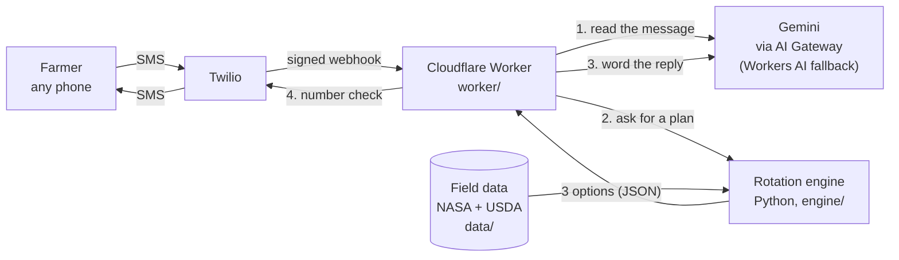
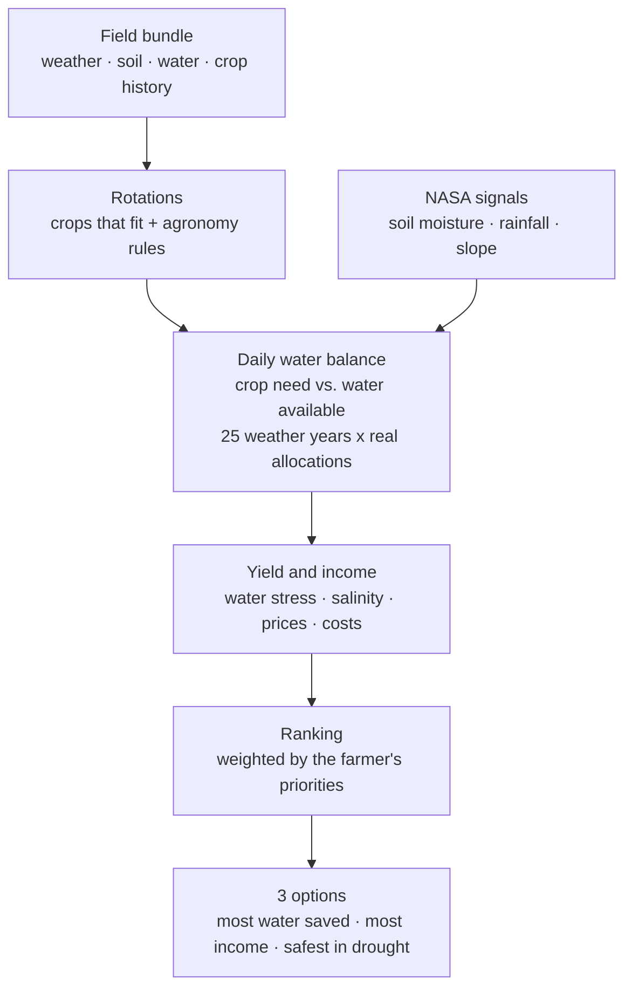

# FarmLine

**NASA's satellites, by text message.** A farmer sends one plain SMS from any phone, with no
internet, and gets back a crop rotation plan for their exact field: what to plant for the next
3 years to save water, protect income and stay safe in a drought.

> *"alfalfa 89406, water is short, what should I plant?"*
>
> FarmLine: Fallon, NV. Plans tested on 25 years of NASA weather.
> 1 saves the most water · 2 earns the most · 3 safest in a drought. Reply 1, 2 or 3 for details.

Built for the **NASA Space Apps Challenge 2026**, challenge *Field Shift: Adapting Farms with
NASA Data*.

## Why

Farmers have to choose rotations years ahead while rain, heat and water supplies shift. The
data that could guide them (25 years of weather, soil surveys, satellite soil moisture, water
allocations) sits in archives and dashboards they never open. Many farms have no internet,
but every farmer can send a text.

What makes FarmLine different from a "pick a field on a map" website:

- **Text first.** Plain SMS on any phone. A call-in line and WhatsApp are planned on top.
- **Field memory.** The USDA Cropland Data Layer knows what grew on the field since 2008, so
  the farmer only sends a ZIP code or town.
- **Stress-tested.** Every rotation is replayed through 25 years of real NASA weather and
  the water allocations farmers actually received, so the answer covers a bad year, not just an
  average one.
- **The farmer decides.** Three options, not one instruction.
- **No made-up numbers.** The model computes; Gemini only words the result, and a checker
  blocks any reply containing a number the model didn't produce.

## How it works



1. **Twilio** delivers the SMS to a **Cloudflare Worker**, which verifies the signature and
   keeps a small memory per farmer (so "tell me more about option 2" works).
2. **Gemini** turns the free-form text into structured facts: crop, place, whether water is
   being cut, and what the farmer cares about most. Only the message text is sent, never the
   phone number.
3. The **rotation engine** loads that field's data, tries about 200 three-year rotations and
   returns the best 3.
4. **Gemini** writes the reply from the engine's numbers only. English is written by the
   model and checked; Hindi, Urdu and Swahili use fixed templates; other languages are
   translated and rejected if any number changes.

### Inside the engine



- **Water balance:** reference evapotranspiration from NASA POWER (Hargreaves), crop
  coefficients from FAO-56, a soil-water bucket sized by the USDA soil survey. Irrigation stops
  when the year's water allocation runs out, which is how a drought reaches the field.
- **Yield and income:** water stress (FAO-33) and soil salinity (FAO-29) cut yields; county
  yields and market prices turn them into dollars.
- **Ranking:** each rotation is scored on water, income, bad-year income (10th percentile)
  and soil health, then weighted by what the farmer asked for.

## Data

| Dataset | Owner | What it does in FarmLine | Status |
|---|---|---|---|
| NASA POWER | NASA | 25 years of daily weather; drives the water balance and the stress test | In use |
| SSURGO soils | USDA NRCS | Water-holding capacity, salinity, slope | In use |
| Newlands Project allocations | TCID, press and board minutes | The share of their water right farmers received each year | In use (11 sourced years) |
| NWIS streamflow | USGS | Carson River flow; independent check on drought years | In use |
| Cropland Data Layer | USDA | What grew on the field each year | Planned |
| FAO-56 / 33 / 29 crop tables | FAO | Crop water need, yield response, salt tolerance | Planned |
| NASS QuickStats, AMS Market News | USDA | County yields and prices | Planned |
| SMAP, GPM IMERG, HLS NDVI, SRTM, ECOSTRESS | NASA | Current soil moisture, rainfall check, crop vigor, slope | Planned |
| OpenET | OpenET | Measured crop water use, to calibrate the model | Planned |

Every number has a source, and years or values with no source are left out, not estimated.
See [docs/DATASETS.md](docs/DATASETS.md).

**Demo field:** an alfalfa field south of Fallon, Nevada, on the Newlands irrigation project.
Its soil is salty clay, it gets 78 to 307 mm of rain a year, and its water allocation fell to
20% in 2015 and 70% in 2021.

## Status

| Part | What works today |
|---|---|
| SMS webhook (`worker/`) | Signed Twilio webhook, per-farmer memory, STOP/HELP handling |
| Gemini layer (`worker/src/gemini/`) | Message parsing in 6 language forms, checked replies, number checker, Hindi speech; tested live |
| Engine (`engine/`) | API with token auth, data loader, daily water balance, ranking, contract checks on every answer |
| Data (`pipeline/`, `data/`) | Real Fallon weather, soil, water allocations and river flow |

**Not finished yet:** the crop tables, rotations and yield model (the engine uses clearly
labelled stand-ins until they land, and marks such answers `sample_data`), connecting the SMS
webhook to the engine, deployment, the Tiger Data store, the officers' dashboard, the call-in
line, WhatsApp and drought alerts.

## Repository

```
worker/      Cloudflare Worker (TypeScript): SMS webhook + Gemini layer
engine/      Rotation engine (Python, FastAPI)
pipeline/    Scripts that fetch each dataset into data/
data/        Field bundles and reference tables
contracts/   The JSON the worker and engine exchange, with samples
docs/        Engine build plan, dataset list, dashboard style spec
```

## Run it

**Engine** (Python 3.11+), from the repo root:

```bash
python -m venv engine/.venv
engine/.venv/Scripts/python -m pip install -r engine/requirements.txt   # bin/ instead of Scripts/ on macOS and Linux
engine/.venv/Scripts/python -m pytest engine/tests pipeline/tests
ENGINE_API_TOKEN=dev engine/.venv/Scripts/python -m uvicorn engine.app:app
```

**Worker** (Node 20+), in `worker/`:

```bash
npm install
npm test
npm run dev    # needs .dev.vars, copied from .dev.vars.example
```

Secrets (Gemini, AI Gateway, Twilio, engine token) live in `.dev.vars` and `.env`, which are
gitignored. Details: [worker/README.md](worker/README.md),
[worker/src/gemini/README.md](worker/src/gemini/README.md) and
[docs/engine-plan/README.md](docs/engine-plan/README.md).

## Tech

TypeScript on Cloudflare Workers (Durable Objects, Workers AI, AI Gateway) · Google Gemini ·
Twilio SMS · Python (FastAPI, NumPy, pandas) · planned: Vultr for the engine, Tiger Data
(TimescaleDB) for time series, Cloudflare Pages for the dashboard.
